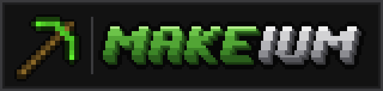
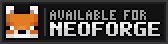
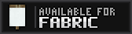

<p align="center"></p>
<p align="center">
  
  
</p>

# Makeium (26.3)

An all-in-one toolkit for Minecraft 26.3 map makers. One pure-Java jar runs on NeoForge and Fabric; there are no executables.
Everything Makeium makes is **vanilla**: display entities, datapacks, resource packs and command blocks. Finished maps play without the mod. Makeium registers no items or blocks, so vanilla clients can still join a Makeium server.

Open the hub with `/makeium` (or the **M** key). Editing needs operator level 2, which singleplayer grants when cheats are on.

[한국어](README.ko.md)

## Features

| Feature | Command | What it does |
|---|---|---|
| Display Factory | `/makeium display` | Place text, block and item displays like blocks. Click a wall or floor and the display sticks flush to that face, centred, like a sign. The editor covers rich text (per-segment colour, decorations, **resource-pack fonts**), background, scale and rotation, interpolation, and keyframe animations you can export as functions. |
| Resource Pack Factory | `/makeium resourcepack` | Makes a pack in `resourcepacks/` and applies it live. Includes a texture browser, a pixel editor (animation frames, PNG drag & drop), custom items (`item_model`), font icons, sounds (.ogg drag & drop), translations and a file editor. Export as a zip or as the world's resource pack. |
| Datapack Factory | `/makeium datapack` | Scratch-style block coding. Combine events (load, tick, join, death, trigger, click, region, dialog, advancement) with 104 blocks. **Every 26.3 command** is available as a block, taken from the server's command tree. Edit every 26.3 datapack file type, with a crafting grid for recipes. Files are checked with the server's real codecs. |
| Trigger regions | `/makeium regions` | Run commands and block-coding events when players enter, leave or stay in a box. |
| Region edit | `/makeium edit` | Fill, walls, replace, clear, copy/paste (rotate, mirror), move, undo. |
| NPCs & dialog | `/makeium npc` | NPCs with branching 26.3 dialogs. Choices use `/trigger`, so they work for every player. |
| Camera cutscenes | `/makeium camera` | Record viewpoints and get a smooth (Catmull-Rom) cutscene function. |
| Scoreboard dashboard | `/makeium scoreboard` | View and edit objectives, scores, teams, boss bars and storage. |
| Test checkpoints | `/makeium checkpoint` | Save a selection before test play and restore it in one click. |
| Map packaging | `/makeium package` | Export a clean zip without player data or working files. |
| Command block editor | open a command block | Multi-line editing, live validation, suggestions and a chain view. You can switch back to the vanilla editor. |

Get a tool with `/makeium tool <id>`: `text_display`, `block_display`, `item_display`, `display_select`, `selection`, `region`, `link`, `npc` or `camera`. Each tool is a vanilla item with `custom_data`.

## Building

```bash
./gradlew build
```

Output: `build/libs/makeium-<version>+mc26.3.jar`, for NeoForge and Fabric.
For development runs use `./gradlew :neoforge:runClient` or `./gradlew :fabric:runClient`. Add `-Pmakeium.devScript=<file>` to run an automated in-game script (see `DevAutomation`).

## Logo

The logo is Minecraft's diamond pickaxe texture recoloured green (`branding/gen_logo.py`). It is not AI-generated art, so every store gets the same jar.

The README banner and the "Available for" badges come from `branding/gen_banner.py`: the same green pickaxe, hand-placed pixel lettering, and vanilla fox and banner textures for the loader icons.

## License

Apache-2.0. The bundled fonts, Noto Sans KR and Courier Prime, are under the SIL OFL 1.1 (`docs/license/`).
